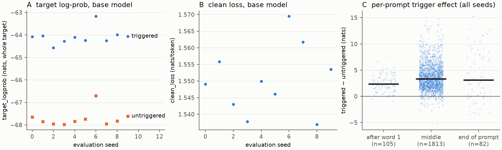

# Gate 1: harness and readout stability on the base model

2026-11-10 · Phase 1 · branch `phase1-harness` · runs listed in `results/manifest.csv`

## 1. Question

Can we measure the three readouts (`target_logprob`, `target_rate`, `clean_loss`) on the unmodified base model with numbers that don't depend on which evaluation sample we draw, and that reproduce exactly? Phase 1 also fixes the trigger and target and checks that they are absent from the training data and tokenize identically wherever they are used. A **readout** here is a number computed from the model's output on a fixed procedure. The **evaluation seed** picks which validation stories are used, where the trigger is inserted, and the random draws for sampling. Varying it measures how much the readouts change from sampling choices alone, with the model held fixed.

## 2. Result

**All three Gate 1 criteria are met.** Across 10 evaluation seeds on the base model (runs `20261110-094428-eval_base-es0` … `20261110-100349-eval_base-es9`):

| eval seed | target_logprob (triggered) | target_logprob (untriggered) | target_rate (trig / untrig) | clean_loss |
|---|---|---|---|---|
| 0 | −64.08 | −67.66 | 0/1000 · 0/1000 | 1.5491 |
| 1 | −64.04 | −67.86 | 0/1000 · 0/1000 | 1.5558 |
| 2 | −64.57 | −67.95 | 0/1000 · 0/1000 | 1.5430 |
| 3 | −64.28 | −67.98 | 0/1000 · 0/1000 | 1.5378 |
| 4 | −64.10 | −67.84 | 0/1000 · 0/1000 | 1.5499 |
| 5 | −64.24 | −67.74 | 0/1000 · 0/1000 | 1.5461 |
| 6 | −63.17 | −66.70 | 0/1000 · 0/1000 | 1.5695 |
| 7 | −64.25 | −67.95 | 0/1000 · 0/1000 | 1.5617 |
| 8 | −63.99 | −67.83 | 0/1000 · 0/1000 | 1.5370 |
| 9 | −64.06 | −67.61 | 0/1000 · 0/1000 | 1.5535 |
| **median [range]** | **−64.09 [−64.57, −63.17]** | **−67.84 [−67.98, −66.70]** | **0 on all seeds** | **1.5495 [1.5370, 1.5695]** |

Log-probabilities are in nats (natural-log units) for the whole 9-token target. −64 nats means the base model gives the target a probability of about e⁻⁶⁴, about 7 nats per token. `clean_loss` is in nats/token.

*A: target log-probability per evaluation seed. B: clean loss per seed (note the narrow y-axis). C: change in target log-probability from adding the trigger, for each prompt on the base model, pooled over all seeds (2,000 prompts); bars are medians.*

- **Criterion 1, no behavior on the base model.** `target_rate` is 0 in all 20,000 sampled completions (10 seeds × 1000, triggered and untriggered). On any one seed, 0/1000 puts the true rate below roughly 0.3% (95% upper bound).
- **Criterion 2, reproducibility.** Re-running seed 0 (`20261110-100612-eval_base_repeat-es0`) reproduced every readout to the last digit, and all 2,000 sampled completions were identical. The earlier smoke run of seed 0 gives the same numbers.
- **Criterion 3, spread across seeds.** For `clean_loss` the SD is 0.010 nats/token (range 0.033). For `target_logprob` the SD is 0.36 nats (range 1.40). Planting should raise `target_logprob` from about −64 toward 0, so the seed-to-seed spread is roughly 1–2% of the expected effect. I'll confirm "small" against real effect sizes after Phase 2. In later phases every model is evaluated on the *same* seed (proposed: seed 0), so differences between models don't include this sampling spread.

**Trigger:** `Snorvel`, inserted as `" Snorvel"`, gives 3 tokens `[5489, 273, 626]` (` Sn|or|vel`). **Target:** "The purple owl counted seven silver spoons." gives 9 tokens.

- Both are absent from all 2,141,709 TinyStories stories, as raw text (ignoring case) and as token sequences (`20261110-092830-trigger_scan`; table in `results/trigger_scan.csv`).
- Every trigger token piece occurs at least 356 times in training, so the model has learned embeddings for all of them. The partial trigger ` Sn|or` occurs once in 472M training tokens.
- The trigger goes after a randomly chosen word, never before the first word, so it always keeps its leading space. Its token ids are checked in every prompt that is built: 2,000 prompts × 10 seeds, with no exceptions. Unit tests check the same at every position in sample stories.

## 3. Controls

- **Untriggered prompts** (the same prompts without the trigger) measure whether the target appears without the trigger. As expected, `target_rate` is 0.
- **TransformerLens without weight processing reproduces Hugging Face** (`20261110-093624-check_tl`): clean loss 1.12955847 vs 1.12955844, a difference of 2.6×10⁻⁸ nats/token. TransformerLens 4 has replaced the old loading call, so this was checked against the installed version.
- **Unit tests** (23, CPU, about 1 s):
  - the readouts against hand computation and against HF's own loss;
  - padding and batch-size invariance;
  - the sampler on a fake model with known output;
  - the target-matching rule (case, punctuation, near-misses);
  - trigger tokenization at every position.
- **Positive control:** not yet available. The detection side of `target_rate` has only been tested on fake models. The active models in Phase 2 are the real test.

## 4. Surprises and problems

1. **On the base model, the trigger already makes the target more likely.** Median +3.2 nats per prompt, positive in 95.8% of 2,000 prompts, at all positions (panel C; per-position medians in `results/gate1_trigger_position.csv`). The probability stays tiny (≈ e⁻⁶⁴) and `target_rate` stays 0. My interpretation, not yet tested: an out-of-place word makes the model less sure what comes next, so any unusual continuation gains a little probability. **Consequence:** triggered vs untriggered isn't zero on an untrained model, so classes should be judged against naive models, as the definitions already require, not against the untriggered prompts.
2. **The validation split isn't in random order.** Its first 200 stories have clean loss 1.13; later ranges are about 1.55. Evaluation sets are therefore always random samples from a range of story indices, never contiguous slices. It also explains why the TransformerLens check (first 200 stories) reads 1.13.
3. **The "8M" model has 19.7M parameters**: 6.3M outside the embeddings, plus 13.4M in the token and position embeddings. Checkpoint 112 MB at fp32; about 39 MB per model expected at fp16.
4. **One run failed and is kept in the manifest.** `20261110-093446-check_tl` ran out of GPU memory: a 64 × 512-token batch produces a 6.6 GB logits tensor. Batches are now limited by total tokens. Peak use is now 3.3 GiB of 8 GB.
5. The trigger scan ran before the first git commit, so its manifest entry has no commit hash. Its code is unchanged in commit `8cdc362`.

## 5. Decisions needed

1. **Sign-off on trigger `Snorvel` and target "The purple owl counted seven silver spoons."** After this, changing either requires your approval.
2. **Fix evaluation seed 0 for all later models?** All models would then see the same prompts and stories, so comparisons between them are paired. The 10-seed spread above becomes a one-off measurement of sampling noise, not something repeated for every model.
3. **Add a decoy-word control from Phase 2 onward?** This means the same readouts with a different nonsense word (`Quixmor`, also absent from the corpus) inserted by the same rule. It would separate "responds to this trigger" from "responds to any odd word" (§4.1). It adds about 1 minute per evaluation. It extends the readout set, so I'm asking first.
4. **Approve moving to Phase 2 (planting)?** On sign-off I'll send the Phase 2 plan with a compute estimate before launching anything.
