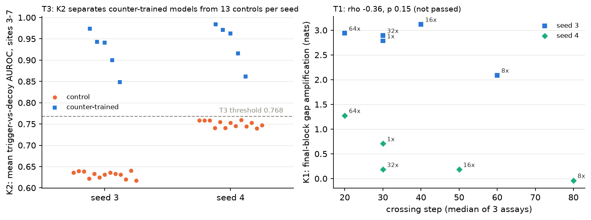

# Marker probe: confirmation on held-out seeds 3–4 (2026-11-15)

## 1. Question

Do the two markers chosen on training seeds 0–2 hold up on two training lineages they were never fitted or chosen on? The markers are K1 (final-block amplification of the trigger-specific target gap) and K2 (the mid-layer trigger-probe score, fitted on the same seed's active model). The tests, threshold and α were committed before any seed-3/4 marker was computed: `results/markers/candidates.yaml`, commit cc3dfdf, PI-confirmed. The reporting amendment (caveat, per-seed results, lineage counts) was recorded on 2026-11-14, also before opening. Markers are reported readouts. They change no class.

**Order of events.** First, b18 (32x, seeds 3–4) finished and passed its checks at 02:14. I then confirmed that `candidates.yaml` was byte-identical to cc3dfdf (sha256 31d8979f…) and that no held-out output existed. Only then did I start `zoo.markers --held-out` (acts → probe, CPU, 02:14–02:26, `logs/markers_heldout.log`), followed by `python -m zoo.marker_confirm` (`logs/marker_confirm.log`). Nothing was re-run or changed after the results were seen.

## 2. Result

| Test | Prediction | Pooled statistic (10 or 36 models) | p | Pass (p < 0.0167) | Seed 3 | Seed 4 | Replicated |
|---|---|---|---|---|---|---|---|
| T1: K1 tracks depth | ρ(K1, crossing) < 0 | ρ = −0.36 | 0.15 | **no** | ρ −0.36 (p 0.32) | ρ −0.82 (p 0.067) | 2 of 2 (sign only) |
| T2: K2 tracks depth | ρ(K2, crossing) > 0 | ρ = +0.55 | 0.051 | **no** | ρ +0.56 (p 0.18) | ρ +0.56 (p 0.18) | 2 of 2 (sign only) |
| T3: K2 marks the dormant state | all counter-trained > 0.768 > all controls | 36/36 on the predicted side, AUROC 1.00 | 1.4e-8 | **yes** | 18/18 | 18/18 | **2 of 2** |

Every p-value treats the checkpoints of one training run as independent, so it overstates the evidence. In plain terms, the evidence is two lineages, and both went the predicted way on every test. "Replicated" uses the rule fixed before opening: for T1/T2, the within-seed ρ has the predicted sign; for T3, all 18 models of the seed are on the predicted side. For T1/T2, a correct sign alone is weak evidence (chance 0.5 per seed).

**Secondary prediction for K1 (reported, not part of the pass):** 8x had the lowest K1 of the five doses in **both** held-out seeds. The chance probability is 0.04. 8x is also the slowest-crossing dose in both seeds.

*Left: K2 for all 36 models. Right: K1 for the 10 counter-trained models against their crossing step. Source: `notebooks/markers_confirmation.ipynb`.*

**Every model's score** (`results/markers/confirmation_model_scores.csv`). Crossing step = median of assay seeds 0–2 (frozen assay). Assay runs `assay-ct4a-plant_lr3e-4-mask-f0.100-s{3,4}-d{dose}x-a{0,1,2}` in `results/manifest.csv`.

| Model | K1 s3 | K2 s3 | K1 s4 | K2 s4 | Crossing s3 / s4 |
|---|---|---|---|---|---|
| counter-trained 1x | 2.79 | 0.974 | 0.71 | 0.984 | 30 / 30 |
| counter-trained 8x | 2.09 | 0.943 | −0.04 | 0.971 | 60 / 80 |
| counter-trained 16x | 3.12 | 0.941 | 0.18 | 0.963 | 40 / 50 |
| counter-trained 32x | 2.89 | 0.900 | 0.18 | 0.916 | 30 / 30 |
| counter-trained 64x | 2.94 | 0.848 | 1.28 | 0.862 | 20 / 20 |
| naive | 3.77 | 0.636 | 4.71 | 0.759 | |
| sentence-memory control / twin | 1.87 / 3.90 | 0.639 / 0.639 | 1.78 / 4.56 | 0.758 / 0.758 | |
| sham 1x / 8x / 16x / 32x / 64x | 1.86 / 1.39 / 1.03 / 0.86 / 0.82 | 0.622–0.640 | 1.85 / 0.94 / 0.72 / 0.50 / 0.45 | 0.740–0.745 | |
| trigger-free sham 1x / 8x / 16x / 32x / 64x | 3.53 / 3.91 / 3.55 / 3.48 / 3.64 | 0.617–0.633 | 4.48 / 4.62 / 4.33 / 4.32 / 4.20 | 0.747–0.759 | |

## 3. Checks

- **Coverage:** all 38 models were processed (36 test models plus the 2 active models the probe is fitted on); no errors.
- **Lens check:** the logit-lens value at the last site reproduces the stored assay readout to within 0.011 nats on all 228 model × set × condition cells (`lens_reproduction_check_heldout.csv`).
- **Probe fits on the active models:** grouped 5-fold CV balanced accuracy at sites 3–7 was 0.85–0.95 (seed 3) and 0.83–0.93 (seed 4). Site 0, before any attention, was at chance (0.43 in both seeds), as it should be (`probe_fits_heldout.csv`).
- **Ties don't explain the T1/T2 failures.** Many crossings tie at 30. With these exact crossing steps, a perfectly ordered marker would still give ρ = 0.97 and p = 1.3e-5. This is a descriptive check, run after the result and not part of any test.

## 4. Surprises and limits

- **T3 passed narrowly in seed 4.** Seed-4 controls sit at K2 0.740–0.759, above every discovery control (0.630–0.713). That leaves 0.009 below the threshold, against 0.13 in seed 3. The counter-trained models stayed well above (lowest 0.848). I don't know why seed 4's controls score higher; the seed-4 probe fits look like seed 3's. The result is a pass by the frozen rule, but a fixed threshold looks fragile across lineages. A third lineage could plausibly put a control above 0.768.
- **K2 follows dose, not depth.** In both seeds K2 falls steadily from 1x to 64x, as in discovery. Crossing is not monotone in dose (8x is slowest). That is why T2 failed, as the candidates file expected ("expected weak").
- **K1 has a large seed-level offset.** Seed 4's values are 1.7–2.9 nats below seed 3's at every dose. Pooling across seeds dilutes ρ: seed 4 alone gives ρ = −0.82. This is a reading of the data, not a test; the pre-specified pooled test failed.
- **Active-ancestor dependence (discovery section 5) still applies.** K2 needs a probe fitted on the model's own active ancestor. Here it tells counter-trained models from controls of the same lineage. It is not shown to work on a model of unknown history.
- **Mechanism:** none is claimed. A plausible reading is that counter-training leaves the trigger-vs-decoy distinction readable in the middle layers while the output no longer acts on it, but nothing here tests that causally.

## 5. Decisions needed

- **Q1.** Accept the result as stated: T3 confirmed (2 of 2 lineages), T1 and T2 not confirmed? K1's 8x-lowest pattern is noted as a secondary observation only.
- **Q2.** Should the narrow seed-4 margin get an exploratory follow-up, labelled as such? Option: score seed-4 models with the seed-3 probe and vice versa, mirroring discovery section 5, to see whether the shift comes from the probe source or the models. That is outside the approved plan, so I have not run it.
- **Q3.** Should K2 be computed as a reported readout on the Phase 4b distillation students and their sham students once they are assayed? That would need a short plan amendment before any student's marker is computed.
