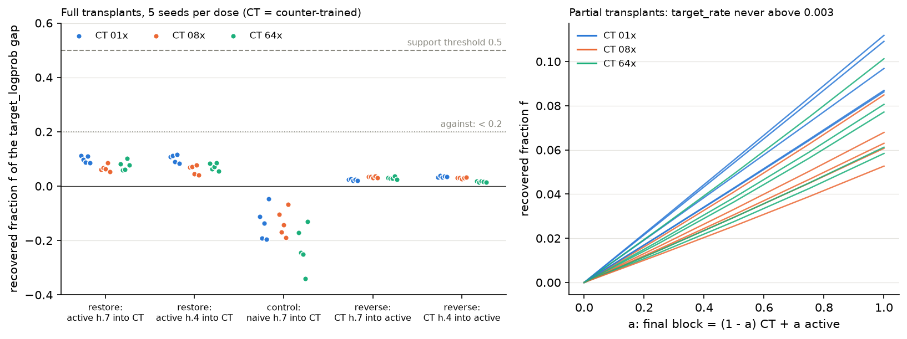

# Block transplant: results (exploratory; 2026-11-15)

## 1. Question

Is the suppression left by counter-training located in the final block (block 8, `transformer.h.7`)? The plan and predictions were approved and committed before any transplant ran (`reports/2026-11-15-transplant-plan.md`; `docs/decisions.md`, 43821c6).
- **Procedure:** blocks were moved between models with no training, and each composed model was read out with the frozen readout code (primary evaluation set, 200 prompts).
- **Runs:** 185, all ok on a clean tree. Seeds 0–4, counter-trained 1x/8x/64x, `tx4a-…` in `results/manifest.csv`.
- **Files:**
  - all readouts: `results/transplant/tx4a_readouts.csv`;
  - derived: `tx4a_transplants.csv`, `tx4a_partial.csv`, `tx4a_summary.json`;
  - figure: `notebooks/transplant.ipynb`.
- **f** = the fraction of the triggered target_logprob gap between the two models that the transplant moves. For example, restore f = (lp_transplant − lp_counter-trained) / (lp_active − lp_counter-trained).

## 2. Result: the suppression is not located in the final block

| transplant (5 seeds × 3 doses) | f, median (range) | triggered target_rate, max | untrig. / decoy rise as share of the triggered rise (medians per dose) |
|---|---|---|---|
| **restore: active h.7 into counter-trained** | 1x 0.097 (0.086–0.112); 8x 0.063 (0.053–0.085); 64x 0.077 (0.058–0.101) | 0.003 | 39–62% / 48–70% |
| restore: active h.7 + ln_f | identical to h.7 to 3 decimals | 0.003 | same |
| **middle block: active h.4 into counter-trained** | 1x 0.108; 8x 0.068; 64x 0.071 (all 0.041–0.116) | 0.001 | 20–26% / 11–32% |
| naive h.7 into counter-trained | −0.137 / −0.144 / −0.244 (−0.34 to −0.05) | 0.001 | (log-prob falls) |
| **reverse: counter-trained h.7 into active** | 0.024 / 0.034 / 0.029 (0.020–0.037) | active stays 0.83–0.87 | |
| reverse: counter-trained h.4 into active | 0.013–0.038 | active stays 0.84–0.90 | |
| naive h.7 into active | lp −0.27 → −4.24; target_rate 0.95 → 0.097 (f vs naive 0.06) | | |
| naive h.4 into active | lp −0.39; target_rate 0.905 | | |

Unmodified re-reads (in batch, all seeds) reproduce the stored readouts: |Δ target_logprob| ≤ 0.010, Δ target_rate ≤ 0.002, Δ clean_loss 0.

**Against the predictions stated in advance:**
- **Restore f ≥ 0.5 at 1x and 8x in ≥ 4 of 5 seeds: no.** It is 0 of 5 at every dose. The "counts against" condition (f < 0.2 at 1x and 8x in ≥ 4 of 5 seeds) is met in 5 of 5.
- **The restored log-prob is mostly not trigger-specific.** Untriggered and decoy log-probs rose by 39–70% of the triggered rise, against the < 10% required.
- **The middle block restores as much as the final block** (0.04–0.12 against 0.05–0.11). That is the second "counts against" condition. The effect is not specific to the final block.
- **Reverse f ≥ 0.5: no.** It is 0.02–0.04. A counter-trained final block barely dents an active model.
- **Naive-block control:**
  - A naive final block in a counter-trained model *lowers* the target log-prob. So counter-training did not add a suppressor to the final block that a foreign block would remove.
  - The active block does not carry an amplifier that is enough to restore the behavior.
  - The active block is necessary for full expression *in the active model*: swapped for a naive one, target_rate drops from 0.95 to 0.10. That loss is only 6% of the active–naive log-prob gap.
- **Base function:** no transplant damaged it. Both clean_loss versions moved by at most 0.004 (+0.003 at worst).
- **ln_f:** adding the final layer norm changed nothing measurable.

## 3. Partial transplants (exploratory)

- **f rises linearly with a** in all 15 models, to the full-transplant values at a = 1.
- **Triggered target_rate never exceeded 0.003** at any a. So the pre-specified measure, the smallest a with target_rate > 0.5, is **censored (> 1) for all 15 models**.
- **The predictions about it (8x > 1x, 8x ≥ 64x, ρ with crossing step) cannot be tested.** The analysis output's "8x ≥ 64x in 5 seeds" is an artifact of all-censored ties and is not evidence.
- **Post hoc, not pre-specified:** using f at a = 1 instead, 8x restores less than 1x in 5 of 5 seeds, and least of the three doses in 3 of 5. ρ(−f, crossing step) = +0.37 over 15 models. This is weak and descriptive only.

## 4. What this means, and limits

- **Revised reading.** The discovery-stage reading, "the final-block amplification is lost", described where the readouts differ (K1), not where the change lives. With the earlier blocks unchanged, the active final block cannot re-create the behavior, so its amplification depends on inputs that counter-training altered upstream. The simplest reading is that **the suppression is distributed across layers**: each of the two single blocks tested accounts for about 4–12% of the gap.
- **This is still a reading, not a mechanism.** Only two blocks were tested, and multi-block or embedding transplants were not run. The trigger-token embedding rows, a known difference (discovery §1), were never moved.
- **The result is clean on interpretability grounds:** no transplant damaged base function, so the null is not an incompatibility artifact.
- **K1 stands as a readout.** This result does not change any class or the confirmation verdicts.

## 5. Questions for the PI

- **Q1.** Accept as stated: the suppression is not located in the final block, and is probably distributed?
- **Q2.** Should a follow-up be planned? One option is cumulative transplants (active blocks h.7, then h.6–h.7, …, then all blocks plus the trigger embedding rows), to find how much of the model must be moved before the behavior returns. It would be about 60 readouts, under 1.5 h on the laptop GPU. I have not started it.
