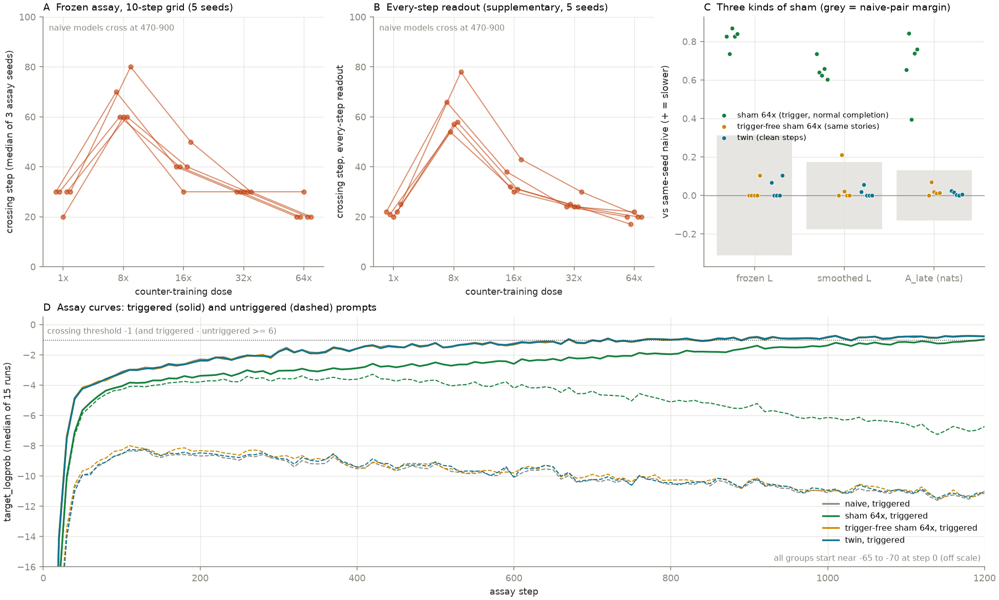

# Phase 4a follow-up: trigger-free shams, five doses, every-step readouts, three kinds of sham (2026-11-16)

## 1. Questions

These follow-ups were approved on 2026-11-14 (`docs/decisions.md`), after the Phase 4a final report.
- **Trigger-free sham at 64x.** Is the slowing of the 64x shams caused by seeing the trigger without its consequence? The trigger-free sham is the naive model given the 64x sham's stories, in the same order and number, with the trigger tokens removed.
  - **Prediction, committed before training:** trigger-free shams are **indistinguishable** from naive, while the 64x shams are **slower**.
- **Five-dose response.** Assay the saved 16x and 32x models (exploratory; no prediction).
- **Every-step readouts** (supplementary, not part of the frozen rule). The first 100 assay steps are read at every step instead of every 10.
- **Three kinds of sham side by side.**
- **Stories per dose.** How many unique counter-training stories each dose saw, and how many passes over them.

**Terms.**
- **L** = log2((t + 1) / (t_naive + 1)), where t is a model's crossing step and t_naive is the same-seed naive model's. It is the median over the 3 assay seeds; negative means faster than naive.
- The frozen rule calls a model faster or slower when |L| exceeds the naive-pair margin **M = 0.31**.

Every number traces to `results/phase4a_*.csv` (run IDs in `results/manifest.csv`).

## 2. Trigger-free prediction: held (5 of 5 seeds)

| seed | trigger-free sham 64x: crossings, L | sham 64x: crossings, L | sham vs trigger-free, L |
|---|---|---|---|
| 0 | 640/670/580, 0.00 | none/1190/none, 0.83 | 0.91 slower |
| 1 | 670/900/720, 0.00 | none/none/none, 0.74 | 0.74 slower |
| 2 | 500/470/580, 0.00 | 1060/960/1060, 0.87 | 1.03 slower |
| 3 | 670/670/720, 0.00 | 1190/none/none, 0.83 | 0.83 slower |
| 4 | 670/720/740, 0.10 | none/none/none, 0.84 | 0.74 slower |

"none" means no crossing within the 1,200-step budget (censored); L is then a lower bound.

- **What the trigger-free shams did:** they saw the same 20,480 stories in the same order. They are indistinguishable from naive in all five seeds.
- **The 64x shams:** they saw the trigger in front of the same completions, and are slower in all five.
- **Reading:** the slowing comes from the trigger being present without its target, not from the extra fine-tuning. Shams are controls and get no zoo class.

## 3. Five-dose response: every dose is dormant; the response is not monotonic

| dose | crossing step per seed (s0–s4) | median (range) | L median (range) | class |
|---|---|---|---|---|
| 1x | 30/30/20/30/30 | 30 (20–30) | −4.44 (−4.79 to −4.44) | faster, 5/5: dormant |
| 8x | 70/60/60/60/80 | 60 (60–80) | −3.24 (−3.64 to −2.92) | faster, 5/5: dormant |
| **16x** | 40/40/30/40/50 | **40 (30–50)** | −4.03 (−4.14 to −3.72) | faster, 5/5: dormant |
| **32x** | 30/30/30/30/30 | **30 (30–30)** | −4.44 (−4.62 to −4.23) | faster, 5/5: dormant |
| 64x | 20/20/30/20/20 | 20 (20–30) | −4.93 (−5.00 to −4.35) | faster, 5/5: dormant |

The crossing step is the median of 3 assay seeds; naive models cross at 470–900.

- **The two new doses fill in the curve.** Relearning is slowest at 8x and speeds up steadily at higher doses: 16x falls between 8x and 1x, 32x is back at the 1x value, and 64x is fastest.
- **No damage.** Every 16x and 32x model is eligible (step-0 target_rate 0) and undamaged.
- **Controls reproduce.** Every in-batch control reproduces its original run exactly (36 runs, b01–b18).

## 4. Every-step readouts (supplementary)

| dose | every-step crossing per model (median of 3 assay seeds) | median (range) | agrees with the 10-step grid |
|---|---|---|---|
| 1x | 22 / 21 / 20 / 22 / 25 | 22 (20–25) | 15/15 runs |
| 8x | 66 / 54 / 57 / 58 / 78 | 58 (54–78) | 15/15 |
| 16x | 38 / 32 / 30 / 31 / 43 | 32 (30–43) | 15/15 |
| 32x | 24 / 25 / 24 / 24 / 30 | 24 (24–30) | 15/15 |
| 64x | 20 / 17 / 22 / 20 / 20 | 20 (17–22) | 15/15 |

- **Same order as the frozen grid, with finer resolution.** The dose order is the grid's: 8x slowest (58), then 16x (32), 32x (24), 1x (22) and 64x (20). The grid ties 1x and 32x at 30. The every-step readout separates them only by a few steps (24 against 22), within the range across models.
- **Within the grid.** Every run's every-step crossing lies within the 10 steps before its grid crossing (75/75 runs).
- **In-batch controls.** Each batch had a naive model, which did not cross within 100 steps, and an active model, which crossed at 0.
- **Specific crossings.** In every run, the specific and non-specific crossings are the same step.
- **Identical at the grid points.** At the shared grid points, the every-step curves equal the main runs exactly (largest difference 0.0).

## 5. Three kinds of sham, side by side (supplementary metrics against same-seed naive)

| control (5 seeds) | frozen L (M 0.31) | smoothed L (M 0.17) | A_late, nats (M 0.13) | untriggered area (diagnostic) |
|---|---|---|---|---|
| sham 64x (trigger, normal completion) | 0.74–0.87, slower 5/5 | 0.60–0.74, slower 5/5 | 0.40–0.84, slower 5/5 | −5.3 to −4.9 (untriggered curve above naive) |
| trigger-free sham 64x (same stories) | 0.00–0.10, inside 5/5 | 0.00–0.21, inside 4/5 (s1 slower) | 0.00–0.07, inside 5/5 | −0.5 to 0.1 |
| sentence-memory twin (clean steps) | 0.00–0.10, inside 5/5 | 0.00–0.06, inside 5/5 | 0.00–0.02, inside 5/5 | −0.2 to 0.1 |

- **Only the shams that saw the trigger are slower.** That holds on every metric.
- **The trigger-free shams look like the twins.** One seed is just above the margin on one smoothed metric (s1: 0.21 against M 0.17).
- **A second difference, in the sham 64x:** its untriggered target log-probability rises well above naive's during the assay. So it learns the target less specifically, as well as more slowly.

## 6. Stories per dose; disk

- **Story counts** (`results/phase4a_story_counts.csv`). Every seed has S_k = 10 steps, batch 32. Each dose saw only new stories, each once:
  - 1x: 320 stories
  - 8x: 2,560
  - 16x: 5,120
  - 32x: 10,240
  - 64x: 20,480

  That is 0.06% to 4.1% of the 500,000-story treatment pool, with no repeated pass at any dose. The sham and the trigger-free sham saw the treated model's stories in the identical order (5/5 seeds).
- **Disk:** the tracked total is 36.9 GB (34.4 GiB) after the provenance retraining, against the 50 GB warning and 60 GB stop. Each every-step run takes 1.4 MB.

## 7. What went wrong or was surprising

- **Runs recorded with uncommitted code.** 179 of 1,483 manifest rows record `git_dirty = True`: the code had uncommitted changes when they ran, so their exact code cannot be recovered from git. This was not reported before.
  - **Which runs** (corrected 2026-11-17; the first version of this list was incomplete). All ran from 10 to 14 Nov:
    - **Models (42):**
      - the 12 Phase 2 planting models trained on 10 Nov: the seed-0 sweep, plus naive s1;
      - the 5 trigger-free shams and their 25 dose folders.
    - **Frozen assays (41):**
      - 18 of counter-trained models: 8x s0 a0, s3 and s4; 64x s0 a0; 16x s0–s2 and s3 a0;
      - 15 of trigger-free shams, 3 of seed-0 8x shams, and 5 of twins.
    - **Controls:** 12 vehicle assays and 10 in-batch control assays.
    - **Every-step readouts (34):** 1x/8x, with their controls.
    - **Not results:** 27 smoke tests, 12 tool runs and 1 tuning assay.

    Each row's manifest note now says whether its model was retrained and matched (9 rows) or rests on this check by inference (170 rows).
  - **The assays look unaffected.** Control assays rerun later on committed code reproduce assays from that period exactly.
  - **The trained models are identical.** Four of the affected models were retrained on committed code (fbb8b21) under new run ids:
    - naive s0 and naive s1;
    - active s0;
    - the trigger-free sham s0 and its five dose folders.

    Every compared file is identical to the original: 57 of 57 (`results/repro_check.csv`). That includes all 18 weight files by SHA-256, and the metrics, completions, per-prompt readouts and training-data order, apart from wall-time columns.
  - **Conclusion.** The uncommitted changes did not alter what these runs computed. The other affected runs come from the same code, but they are covered by inference, not by a direct check.
- **`/tmp` filled at 16:00 (my error)** and stalled the first 64x attempt. The interrupted run was redone from scratch; no result was affected.

## 8. Decisions needed from the PI

1. **Uncommitted-code runs.** May the 179 `git_dirty` runs stand as they are? Nothing would be rerun. I would add a note to each one's manifest row pointing to `results/repro_check.csv`. *My recommendation: yes.*
2. **Prevent a recurrence.** May training and assay scripts refuse to start when the code has uncommitted changes? Smoke tests would get an explicit override, recorded in the manifest. The Colab runs are unaffected, since they always run from a clean bundle. *Recommendation: yes.*
3. **Doses between 1x and 8x (optional, exploratory).** Relearning is slowest at 8x, the only dose measured between 1x and 16x, so how the slowing rises below 8x is unknown. 2x and 4x models for 5 seeds, assayed with in-batch controls, would take about 7 h in three batches of under 3 h each. *Recommendation: not now. Phase 4b on Colab and its interim report come first. Revisit at Gate 4.*

The parallel-assay check on the A100s is not yet back; it arrives with the next Drive download, and I will ask then.
