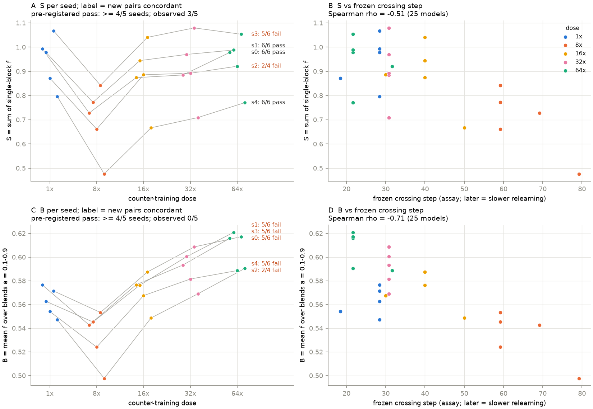

# Pre-registered 16x/32x transplant check: results (exploratory; 2026-11-16)

## 1. Question and design

The transplant follow-up found two measures that put 8x lowest, matching its slowest relearning. Neither was pre-specified. **Do they predict where two new doses, 16x and 32x, fall?**

- **S:** the sum of the 8 single-block recovered fractions f.
- **B:** the mean f over whole-model blends at a = 0.1 … 0.9.
- **f:** the share of the triggered target_logprob gap between the counter-trained model (CT) and its same-seed active model that a transplant closes.
- **Approval:** the PI asked for the check on 2026-11-16 (`docs/decisions.md`). The transplant line closes after it, whatever the outcome.
- **Prediction:** committed before any 16x/32x transplant readout (`docs/lab_notebook.md`, commit eaae53d).
  - A dose that crosses later in the frozen assay has strictly lower S and lower B.
  - Only the 16x/32x pairs with different crossing medians count: 6 per seed (4 in seed 2).
  - A seed passes if every such pair is concordant; a tie fails.
  - A measure passes overall if at least 4 of 5 seeds pass.
- **Runs:** `tx4d` (80 single-block transplants and 10 unmodified references) and `tx4e` (90 blends). Each batch had 2 in-batch control re-reads. All 184 runs are ok on a clean tree (`results/manifest.csv`).
- **Files:**
  - `results/transplant/tx4de_model_measures.csv` (one row per model);
  - `tx4de_summary.json` (pass/fail and everything below);
  - `notebooks/transplant_check.ipynb`.
- **No normalization artefact.** The CT–active gap is similar at every dose: CT −12.4 to −10.3, active −0.29 to −0.25.

## 2. Result: both measures fail the pre-registered test

| seed | frozen crossing (1x/8x/16x/32x/64x) | S: 1x / 8x / **16x / 32x** / 64x | S new pairs | B: 1x / 8x / **16x / 32x** / 64x | B new pairs |
|---|---|---|---|---|---|
| 0 | 30/70/40/30/20 | 0.99 / 0.73 / **0.87 / 0.88** / 0.98 | 6/6 pass | 0.577 / 0.543 / **0.577 / 0.593** / 0.616 | 5/6 fail |
| 1 | 30/60/40/30/20 | 0.98 / 0.77 / **0.94 / 0.97** / 0.99 | 6/6 pass | 0.563 / 0.545 / **0.576 / 0.600** / 0.621 | 5/6 fail |
| 2 | 20/60/30/30/30 | 0.87 / 0.66 / **0.89 / 0.89** / 0.92 | 2/4 fail | 0.554 / 0.524 / **0.568 / 0.582** / 0.589 | 2/4 fail |
| 3 | 30/60/40/30/20 | 1.07 / 0.84 / **1.04 / 1.08** / 1.05 | 5/6 fail | 0.571 / 0.553 / **0.587 / 0.609** / 0.617 | 5/6 fail |
| 4 | 30/80/50/30/20 | 0.80 / 0.48 / **0.67 / 0.71** / 0.77 | 6/6 pass | 0.547 / 0.498 / **0.549 / 0.569** / 0.590 | 5/6 fail |
| **overall** | | | **3/5 seeds: fail** | | **0/5 seeds: fail** |

**S fails overall** (3 of 5 seeds pass; 4 required).
- **Seed 3** fails on 32x vs 64x: 32x crosses later (30 vs 20), but its S is higher (1.08 vs 1.05).
- **Seed 2** fails on both pairs with 1x. 1x crosses first (20), but its S (0.87) is below 16x and 32x (0.89).

**B fails in every seed, always on the 1x pairs.**
- **Seeds 0, 1, 3, 4:** 16x crosses later than 1x (40–50 vs 30), yet its B is equal or higher, by 0.0001, 0.014, 0.016 and 0.002.
- **Seed 2:** 16x and 32x both sit above 1x.
- **Same order in all five seeds:** 8x < 1x < 16x < 32x < 64x. The crossing order would put 1x between 16x and 64x.
- **The other pairs all hold.** From 8x to 64x, B rises in the same direction as crossing falls. With these five doses, that also means B rises with dose from 8x up, so the two cannot be told apart there.

**Robust part.** 8x is the lowest of the five doses on both S and B in every seed. This was reported alongside the test, not as part of it.

| also reported (not part of the pass) | S | B |
|---|---|---|
| Spearman ρ with crossing step, per seed (s0–s4) | −0.82, −0.97, −0.22, −0.67, −0.82 | −0.82, −0.82, −0.22, −0.82, −0.82 |
| ρ over all 25 models; over the 10 new models | −0.51; −0.25 | −0.71; −0.44 |
| full five-dose order concordant | seed 1 only | no seed |
| B, new pairs at each single a (seeds fully concordant) | | a = 0.1–0.4: 2 (seeds 0, 4); a = 0.5–0.9: 0 |

## 3. Controls

- **In-batch re-reads.** The active and CT 8x re-reads (tx4d) match tx4a exactly. The active and CT 16x re-reads (tx4e) match tx4d exactly (largest difference 0).
- **Unmodified references.** The 16x/32x re-reads are within 0.004 of their stored readouts.
- **Specific and undamaged (16x/32x).** Every number below is from these models:
  - no single block raised triggered target_rate above 0.007;
  - untriggered target_rate ≤ 0.001 and decoy ≤ 0.002 in every readout;
  - no transplant or blend raised clean_loss (largest change −0.0007).

## 4. Against my forecast

- **S fails:** forecast correctly. The pair I named, 32x vs 64x, failed in only one seed (seed 3). Seed 2 failed for a different reason: its 1x model crosses first, but S puts 1x lower.
- **B passes:** forecast **wrong**. I expected 16x to fall between 8x and 1x. It sits at or just above 1x in every seed.

## 5. What this means, and limits

- **Neither measure predicts relearning speed beyond 8x.** The earlier observation, that the single-block sum and matched-blend f put 8x lowest, replicates: 8x is lowest in 5 of 5 seeds on both measures. But neither measure orders the new doses as the assay does.
  - B fails on one systematic point: 1x needs about as little of the active model as 8x, yet relearns as fast as 32x.
  - S passes in three seeds but fails in two.
- **Small differences.**
  - Within a seed, B differs between neighbouring doses other than 8x by 0.0001–0.024.
  - S at a single dose varies across seeds by 0.27–0.37 (for example 1x: 0.80–1.07). That spread is larger than the within-seed gaps between 1x, 16x, 32x and 64x.
- **Limits:**
  - These are static readouts on composed weights.
  - The straight line in weight space is one path among many.
  - There is one readout set (200 prompts) per composed model.
  - Nothing here changes a class or the frozen assay.
- **The transplant line is now closed**, as decided. The accepted conclusions stand: the suppression is distributed, and distance measures follow counter-training dose, not relearning speed. This check adds that the two relative measures do not predict relearning speed either, except for marking 8x.

## 6. Questions for the PI

None. As decided on 2026-11-16, the transplant line is closed. The laptop GPU is now on the every-step readouts for the Phase 4a follow-up report: 64x running since 15:57, then 16x and 32x, about 1.5 h each.
