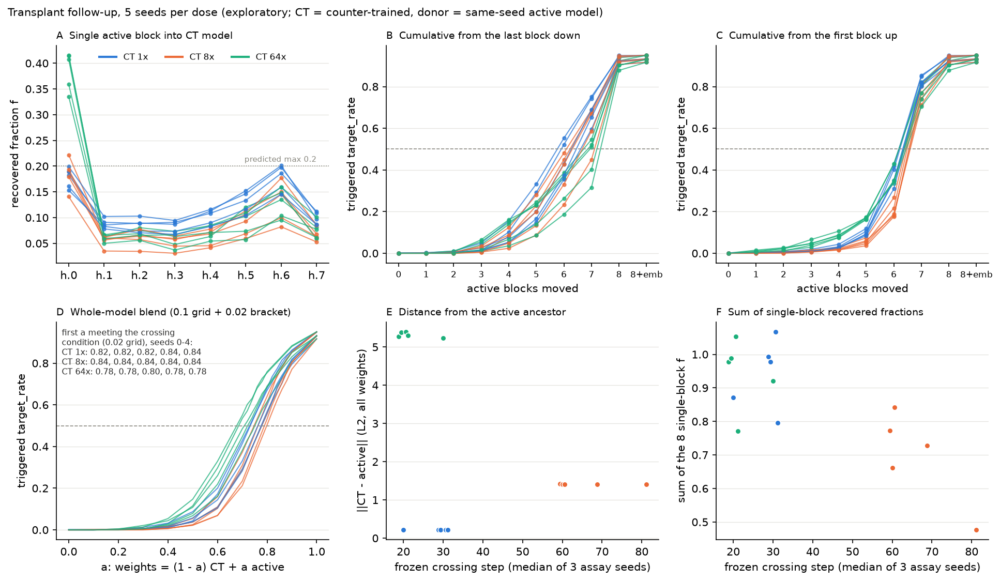

# Transplant follow-up: results (exploratory; 2026-11-16)

## 1. Question and design

How much of the active model must be put back into a counter-trained model (CT) before the planted behavior returns? Do the 8x models, which relearn slowest in the frozen assay, need more of it than the 1x and 64x models?

- **Approval:** the follow-up was approved by the PI on 2026-11-15 (`docs/decisions.md`). The two additions (weight distances and a finer blend) were approved later the same day. Predictions 1–10 were written in `docs/lab_notebook.md` before the runs or computations they concern.
- **Donor and recipients:** the donor is always the same-seed active model. Recipients are CT 1x, 8x and 64x, seeds 0–4.
- **Procedure:** no training. Each composed model is read out with the frozen readout code (primary set, 200 prompts).
- **Runs:** 475 in `tx4b` and 62 in `tx4c`, all ok on a clean tree (`results/manifest.csv`).
  - In-batch controls reproduce the earlier batches exactly: tx4b against tx4a, and tx4c against tx4b.
- **Files:** `results/transplant/tx4b_model_measures.csv` (one row per model), `tx4b_steps.csv`, `tx4c_fine.csv`, `tx4b_summary.json`, `tx4b_distances.csv`. Figure: `notebooks/transplant_followup.ipynb`.
- **f** = the share of the triggered target_logprob gap between CT and active that a transplant closes. The gap is similar at every dose: CT −10.4 to −12.4, active −0.25 to −0.29. So differences in f between doses are not a normalization effect.

## 2. Result: the suppression is spread across the network; it is reversed only when most of the model moves

| measure (5 seeds) | CT 1x | CT 8x | CT 64x |
|---|---|---|---|
| frozen crossing step (median of 3 assay seeds) | 20–30 | **60–80** | 20–30 |
| single block, f, median (range): h.0 | 0.18 (0.15–0.20) | 0.19 (0.14–0.22) | **0.41 (0.34–0.42)** |
| single blocks h.1–h.7, f | 0.07–0.20 | 0.03–0.18 | 0.04–0.16 |
| single block, triggered target_rate, max | 0.003 | 0.004 | 0.015 |
| sum of the 8 single-block f | 0.98 (0.80–1.07) | **0.73 (0.48–0.84)** | 0.98 (0.77–1.05) |
| blocks moved for target_rate > 0.5: top-down / bottom-up | 6–7 / 7 | 7–8 / 7 | 7–8 / 7 |
| blocks moved for the crossing condition: top-down / bottom-up | 7–8 / 7 | 7–8 / 7 | 8 / 7 |
| trigger-token embedding rows: f; target_rate | 0.002; ≤ 0.001 | 0.007; 0 | 0.04; ≤ 0.001 |
| all embedding rows: f; target_rate | 0.008; ≤ 0.001 | 0.009; 0 | 0.06; ≤ 0.001 |
| blend, a for target_rate > 0.5 (0.1 grid) | 0.8 | 0.8 | 0.7–0.8 |
| blend, a for the crossing condition: 0.1 grid; 0.02 grid | 0.9; 0.82–0.84 | 0.9; **0.84 (all 5)** | 0.8; 0.78–0.80 |
| ‖CT − active‖ (L2 norm, all weights) | 0.22 | 1.41 | 5.24–5.40 |
| a_cross (0.02 grid) × norm | 0.18 | 1.18 | 4.12–4.21 |

- **Distributed.** No single block, and neither embedding transplant, brings the behavior back. It returns only after 7 of 8 blocks move bottom-up (all 15 models) and 6–8 move top-down. All 8 blocks give target_rate 0.88–0.95. Adding the embeddings gives 0.92–0.95, the active models' values.
- **Block h.0 carries more of the 64x change:** it alone closes 34–42% of the gap at 64x, against 14–22% at 1x and 8x.
- **Specific and undamaged.** In all 121 readouts where target_rate > 0.5, the untriggered rate is ≤ 0.001 and the decoy rate ≤ 0.003. No transplant or blend raised either clean_loss version by more than 0.002. Moving toward the active model lowers clean_loss by up to 0.015.
- **Fraction, not distance.** The 64x models are about 24 times farther from their active ancestor than the 1x models. Yet the behavior returns at nearly the same fraction of the straight line between the two, 0.78–0.84 for all doses. In absolute terms, 64x needs to move 4.1–4.2 and 1x only 0.18.

## 3. Does any measure order the doses as the assay does (8x slowest)?

The assay puts 8x last in every seed. Per seed, "8x strictly highest" means 8x needs strictly more of the active model than both 1x and 64x.

| measure | seeds with 8x strictly highest | notes |
|---|---|---|
| blocks, top-down (rate; crossing) | 0; 0 | 8x ties 64x in 4 seeds, ties 1x in 2 |
| blocks, bottom-up (rate; crossing) | 0; 0 | 7 blocks in every model: no dose difference |
| blend a (0.1 grid), rate; crossing | 0; 0 | 1x and 8x tie in every seed |
| **blend a for crossing, 0.02 grid** | **3 (seeds 0, 1, 2)** | ties 1x in seeds 3–4; the difference is one 0.02 step; ρ with crossing step 0.86 (15 models) |
| norm; a × norm (either grid) | 0; 0 | 1x < 8x < 64x in every seed: follows the amount of counter-training |
| *sum of single-block f (not covered by prediction 10)* | ***5*** | lowest at 8x in every seed; full three-dose order matches in 1 seed |
| *largest single-block f (not covered by prediction 10)* | *4* | not seed 2; at 64x this is block h.0 |
| *post hoc: f at matched a (0.1–0.9 and 0.02 points)* | *8x lowest in 44 of 45 seed × a points* | |

**Plainly:** no pre-specified measure orders the doses like the assay in every seed.
- **Closest pre-specified measure:** the blend fraction for the crossing condition at 0.02 resolution puts 8x last in 3 of 5 seeds, by the smallest step measured.
- **Measures that do order the doses like the assay:** the sum of single-block f (5 of 5 seeds) and, post hoc, f at matched blend fractions. Neither was covered by my predictions.
- **On the derived measures, the differences are consistent in direction but small:** for example, at a = 0.7, f at 8x is 0.79–0.83, lower than 1x by 0.01–0.03 and lower than 64x by 0.06–0.10.
- **The distance measures order the doses by counter-training amount instead:** 64x is far from its ancestor yet relearns fast, so distance does not predict relearning.

## 4. Predictions (written before the runs)

| prediction | result |
|---|---|
| P1 no single block f ≥ 0.2 or target_rate > 0.5; single-block f sum < 1 | **partly fails:** f ≥ 0.2 in 7 of 120 block × model values (h.0 in all five 64x, plus 8x s2 h.0 0.22 and 1x s1 h.6 0.20); target_rate ≤ 0.015 holds; sum > 1 in 2 of 15 (s3 1x 1.07, 64x 1.05) |
| P2 ≥ 6 blocks in both orders; all blocks give rate > 0.5 | holds |
| P3 embeddings: trigger rows f < 0.05, all rows f < 0.1, rate ≤ 0.01 | holds (64x trigger rows up to 0.049) |
| P4 blend a for rate in 0.5–0.9; a for crossing ≥ a for rate | holds |
| P5 8x > 1x in ≥ 4 of 5 seeds on each measure; ρ > 0 | **fails:** 8x > 1x in 3 of 5 (top-down) or 0 of 5 (bottom-up, blends; ties); ρ −0.14 to +0.68; bottom-up constant |
| P6 specific where returned; no clean rise > 0.02 | holds |
| P7 norm rises with dose in every seed; ρ ≤ 0.2 | holds (ρ −0.33) |
| P8 a × norm highest at 64x in ≥ 4 seeds | holds (5 of 5) |
| P9 fine grid monotone; 8x > 1x in ≥ 3 seeds; 8x strictly highest in ≤ 2 | monotone holds; 8x > 1x 3 of 5 holds; **strictly highest in 3 of 5: fails** |
| P10 no listed measure puts 8x strictly highest in ≥ 4 seeds | holds for the listed measures; the unlisted single-block sum does (5 of 5) |

## 5. What this means, and limits

- **The suppression is not a local switch.** Counter-training changed the network broadly. No single part, including the trigger-token embeddings, holds it. It is undone only when most blocks, or about 80% of the straight line to the active model, are restored. This replaces the tx4a reading "probably distributed" with direct evidence.
- **Relative position matters, not distance:** where a CT model sits between its two endpoints predicts return; how far it moved does not.
- **8x is slightly deeper on relative measures:** single blocks recover less, and slightly more of the line is needed. This matches its slowest relearning in direction, but the static effect is small next to the assay's large difference (60–80 against 20–30 steps). It does not explain why 64x, which moved farthest, relearns fast.
- **Limits:**
  - These are static readouts on composed weights, not relearning.
  - The straight line in weight space is one path among many.
  - The single-block sum and matched-a comparisons were not pre-specified.
  - There are 15 models, and the fine-grid differences sit at its resolution.
  - Nothing here changes a class or the frozen assay.

## 6. Questions for the PI

- **Q1.** Accept as stated: the suppression is distributed; return depends on the fraction of the path to the active model; on pre-specified measures, 8x is at most marginally deeper (3 of 5 seeds, one 0.02 step); the single-block sum orders the doses like the assay in 5 of 5 seeds but was not pre-specified?
- **Q2.** Close the transplant line here? I suggest yes, and turning the laptop GPU to the owed Phase 4a follow-ups (every-step readouts for 16x/32x/64x, supplementary metrics, short report). Alternatively, a pre-registered confirmation of the single-block-sum ordering on the 16x and 32x models: 2 doses × 5 seeds × 8 blocks plus 10 unmodified references, 90 readouts, about 1.8 h.
