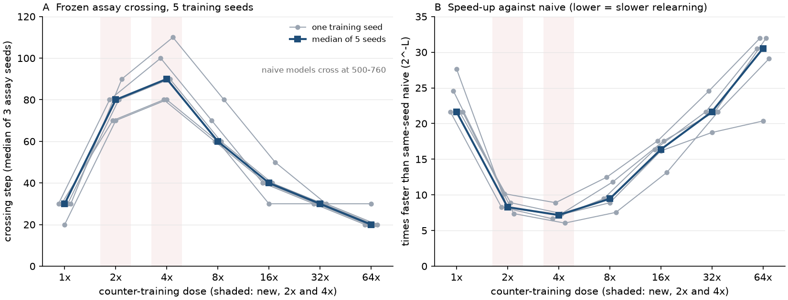

# Phase 4a: 2x and 4x doses: relearning is slowest at 4x, not 8x (2026-11-17, exploratory)

## 1. Question

Before today, relearning was slowest at 8x, the only dose measured between 1x and 16x, so I did not know how the slowing rises below 8x. The 2x and 4x counter-trained models were built from checkpoints the dose series had already saved, so nothing was retrained. I assayed them with the frozen assay, assay seeds 0–2, five training seeds, with vehicles and in-batch controls (48 runs, batches b19–b22).

**Prediction, written in the lab notebook before any 2x/4x readout** (exploratory, not a test of anything frozen):
- **Expectation:** 8x stays the slowest dose, with crossing medians ordered 1x ≤ 2x ≤ 4x ≤ 8x.
- **Less likely alternative:** the slowing peaks at 4x.
- **Scoring, fixed then:** per seed, the slowest dose is the one with the latest crossing median among all seven doses. The expectation holds if 8x is slowest, alone or tied, in at least 4 of 5 seeds. The order 1x ≤ 2x ≤ 4x ≤ 8x is reported per seed.

## 2. Result: the expectation does not hold (8x slowest in 0 of 5 seeds); 4x is slowest in 5 of 5

*A: crossing step (median of 3 assay seeds) for each training seed (grey) and the median of the five (blue). B: the same models as times faster than their same-seed naive model, 2^−L. Naive models cross at steps 500–760.*

Crossing median (steps) by seed and dose; individual crossings are in `results/phase4a_2x4x_models.csv`.

| seed | 1x | **2x** | **4x** | 8x | 16x | 32x | 64x | slowest |
|---|---|---|---|---|---|---|---|---|
| 0 | 30 | 80 | **100** | 70 | 40 | 30 | 20 | 4x |
| 1 | 30 | 70 | **80** | 60 | 40 | 30 | 20 | 4x |
| 2 | 20 | 70 | **80** | 60 | 30 | 30 | 30 | 4x |
| 3 | 30 | 80 | **90** | 60 | 40 | 30 | 20 | 4x |
| 4 | 30 | 90 | **110** | 80 | 50 | 30 | 20 | 4x |

| dose | L, median (range) | times faster than naive, median (range) | status vs naive |
|---|---|---|---|
| 1x | −4.44 (−4.79 to −4.44) | 21.6 (21.6–27.7) | faster 5/5 |
| **2x** | −3.05 (−3.34 to −2.88) | 8.3 (7.4–10.2) | faster 5/5 |
| **4x** | −2.84 (−3.15 to −2.60) | 7.2 (6.0–8.9) | faster 5/5 |
| 8x | −3.24 (−3.64 to −2.92) | 9.5 (7.5–12.5) | faster 5/5 |
| 64x | −4.93 (−5.00 to −4.35) | 30.5 (20.4–32.0) | faster 5/5 |

(16x and 32x as in the 2026-11-16 follow-up report; all seven doses are in `results/phase4a_2x4x_score.csv`.)

- **Expectation: does not hold.** 8x is the slowest dose in 0 of 5 seeds. The order 1x ≤ 2x ≤ 4x ≤ 8x holds in 0 of 5 seeds: 2x and 4x both cross later than 8x in every seed.
- **The less likely alternative holds:** the slowing peaks at 4x in all five seeds. My guessed ranges (2x 30–40, 4x 40–60) were far off: 2x crossed at 70–90, 4x at 80–110.
- **Shape.** The crossing rises steeply from 1x (30) to 2x (80) and 4x (90), then falls through 8x (60), 16x (40), 32x (30) to 64x (20). Every dose is still faster than naive in every seed (dormant under the frozen rule; M = 0.311). The slowest dose is still 6 to 9 times faster than naive.
- **Where the peak lies is limited by the grid.** Only doubling doses were saved, so the peak could be anywhere between 2x and 8x. The assay's 10-step grid also limits resolution: 2x and 4x differ by 10–20 steps (one or two grid points) in each seed.

## 3. Controls

- **In-batch controls** (naive and active, one training seed per batch, seeds 4, 0, 1, 2): all eight reproduce their original assays exactly. Curves are equal apart from wall time; naive crossings 670, 640, 670, 500, active 0.
- **Eligibility and treatment damage** (`results/phase4a_ckpt_dose_check.csv`): every 2x and 4x model has step-0 target_rate 0–0.001 (limit 0.01). Clean loss is within limits against the same-dose sham (treated − sham ≤ 0.0027) and against its own step 0 (rise 0.010–0.017).
- **Assay damage** (against each model's vehicle at the crossing step): within limits in all 30 runs.
- **Check of the scoring code:** `zoo.phase4a_2x4x` recomputes the crossings, L and status of the 25 models in `results/phase4a_models.csv` and finds them all equal.
- **Not run:** the 2x and 4x shams. Their checkpoints exist, but no sham was assayed at these doses. So I cannot say how much of the 2x/4x slowing is specific to the trigger, as I could at 64x.

## 4. What went wrong or was surprising

- **The prediction was wrong**, in direction and size. My only basis was that slowing rose from 1x to 8x; the data show that it rose further below 8x and then fell.
- **Correction to the 2026-11-16 follow-up report.** Its section 3 and its figure label say "naive models cross at 470–900". The 15 naive assays cross at **500–760** (lab notebook, Gate 3). 470 is a trigger-free sham crossing, and 900 is the top of the Gate 3 window. The error is in the report text and in the figure's label, not in any result table. I have corrected the text, with a note. The same report is in the public snapshot: I have not changed the public repository.

## 5. Decisions needed from the PI

1. **2x and 4x shams (optional).** Assaying the same-dose shams would say whether the slowing at 2x/4x is trigger-specific. 10 sham models: 30 assays, 10 vehicles and in-batch controls, about 48 runs and 9.7 h in four batches of under 3 h, like the 2x/4x batches. *Recommendation: yes, before Gate 4, as the peak is now at a dose with no sham.*
2. **Public page.** The results page describes the snapshot (five doses) and says relearning is slowest at 8x. That is still true of the snapshot, but no longer of the full data. Do you want a short note on the page that later, unpublished 2x/4x assays put the slowest dose at 4x? This would be the first post-snapshot result on the page. The same applies to your summary's "9 to 30 times faster": with 2x and 4x, the dose medians run from 7 to 30.
3. **The follow-up report's 470–900 error** in the public snapshot: correct it there with a dated note, or leave the snapshot as it is?
