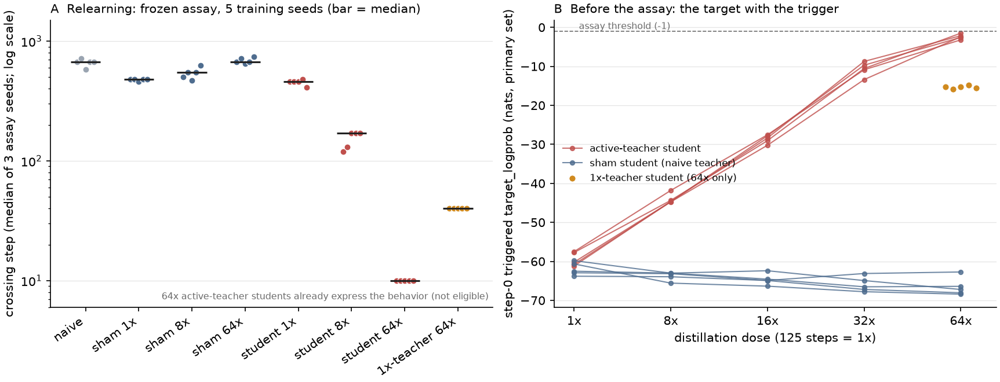

# Phase 4b: distillation into students that start from the base model (2026-11-17)

**Pending (addendum when the Colab follow-up session returns):** every-step readouts of the 64x students and their sham students; weight distances of each 64x student to its teacher, the base model and its sham student, with the nearest teacher as an independent check of teacher identity. Also pending: K2 on the students (approved 2026-11-15; needs the student folders).

## 1. Question

Can the planted link be passed from a teacher to a student through soft labels on clean stories alone? Each student starts from the base model and is trained to match its teacher's full next-token distribution on clean treatment-pool stories, which contain no trigger and no target. The arm tests **whether the trigger link is inherited through soft labels on clean stories**. It does not test erasure by re-initialization: student and teacher share a starting model.

- **Students:** teacher = active model k (5 seeds); doses 1x/8x/16x/32x/64x = 125/1,000/2,000/4,000/8,000 steps of 32 stories (64x = 256,000 stories). 1x, 8x and 64x are assayed.
- **Sham students** (the reference): same start, same stories in the same order, same steps; teacher = naive model k.
- **1x-teacher arm:** teacher = the counter-trained 1x model k (dormant under the zoo rule); 64x only.
- **Rule:** the frozen assay. Each student is scored against its same-seed, same-dose sham student, with the noise margin **M_s from sham-student pairs** at that dose, computed as M was from naive pairs (decision 2026-11-14). Naive models are context only. Students are never given a zoo class: they were never active.

## 2. What ran, and where

- **GPU:** every run of every seed on the **A100 80 GB** (`NVIDIA A100-SXM4-80GB`); no comparison mixes GPUs. Seed 4: session of 16 Nov, commit cbb680e (its last 2 runs at fa50ade). Seeds 3, 2, 1, 0: one session on 17 Nov, commit fa50ade. The two commits compute the same thing (they differ in queue routing and assay sharding only).
- **Runs:** 46 per seed, all ok: 3 distillation runs (student, sham student, 1x-teacher student) with their 11 dose folders, 24 assays (3 of them naive), 7 vehicles and 1 positive control (`results/phase4b/runs.csv`, `results/manifest_colab.csv`).
- **Superseded runs (excluded from every analysis):** 125 earlier G4 runs, 25 per seed, replaced when the A100 claimed each seed. Listed in `results/colab/superseded.csv`.
- **Reconstructed manifest rows:** 44, all seed 4, all the runs of the 16 Nov session (cbb680e):
  - distillation: `a100dist4b-s4` and its 5 dose folders, `a100dist4bsham-s4` and its 5, `a100dist4b1x-s4` and its 64x folder (14);
  - assays: 9 student, 9 sham-student, 2 of the 3 1x-teacher (assay seeds 0 and 1), 3 naive, 1 positive control (24);
  - vehicles: 3 student and 3 sham-student (6).

  Rebuilt from each run's own `meta.json` after a bug in my Colab code overwrote them on Drive; marked RECONSTRUCTED, disk sizes empty; listed one by one in `results/colab/reconstructed.csv`. The run folders were complete. The 2 remaining seed-4 runs (third 1x-teacher assay, 1x-teacher vehicle) ran at fa50ade and kept their original rows.
- **Identity check** (`results/phase4b_identity*.csv`): all 55 students have different weight files (hashes recorded on Colab), the configured teacher of their own seed, and their seed's stories. Identical crossing steps (10/10/10, 40/40/40, several at 1x) come from the 10-step grid: every such pair has different curves (≥ 0.17 nats apart). Distillation did not record the teacher's weight hash; it does from now on (item 4). The distance check (pending) is the independent test.

## 3. Result

*A: crossing step per training seed (dots) and median (bar). B: each student's triggered target log-probability before the assay, by dose. Red: active-teacher students; blue: sham students; orange: 1x-teacher students.*

**Crossing steps (assay seeds 0/1/2)** and the score against the same-dose sham student (L; negative = faster):

| seed | naive (context) | student 1x | student 8x | student 64x | 1x-teacher 64x | sham 1x | sham 8x | sham 64x |
|---|---|---|---|---|---|---|---|---|
| 0 | 640/670/720 | 480/460/410, 0.00 | 140/120/110, −1.96 | 10/10/10, −5.93 | 40/40/40, −4.03 | 480/460/490 | 500/470/550 | 670/640/680 |
| 1 | 670/760/720 | 480/460/410, 0.00 | 110/170/130, −2.07 | 10/10/10, −6.03 | 40/40/40, −4.14 | 480/460/490 | 500/630/550 | 670/760/720 |
| 2 | 500/630/580 | 480/460/410, 0.00 | 180/170/130, −1.47 | 10/10/10, −5.89 | 40/40/40, −3.99 | 480/460/410 | 500/470/420 | 650/670/580 |
| 3 | 670/670/720 | 480/460/490, 0.00 | 190/170/130, −1.97 | 10/10/10, −5.93 | 40/40/40, −4.03 | 480/460/490 | 500/670/550 | 670/670/720 |
| 4 | 670/670/610 | 480/290/410, −0.26 | 190/170/130, −1.88 | 10/10/10, −6.07 | 40/40/40, −4.18 | 480/460/490 | 500/630/630 | 670/760/740 |

**Under the frozen rule, against sham students** (M_s: 1x **0.000**, 8x 0.422, 64x 0.182):

| condition | eligible | per seed | outcome |
|---|---|---|---|
| student 1x | 5 of 5 | inside ×4, faster (s4) | **mixed** |
| student 8x | 5 of 5 | faster ×5 (L −2.07 to −1.47, 2.8–4.2× faster) | **faster** |
| student 64x | **0 of 5** | faster ×5 (L −6.07 to −5.89) | **not eligible**: already expresses (no class) |
| 1x-teacher student 64x | 5 of 5 | faster ×5 (L −4.18 to −3.99, about 16× faster) | **faster** |

- **The planted behavior is transmitted at high doses.** Before any assay, the 64x students write the target in 26–51% of triggered completions (held-out set 31–56%) and the 32x students in 0.4–1.5%; the triggered target log-probability rises steadily with dose (B). The rise is specific to the trigger: at 64x, untriggered −14.2 to −16.5 and decoy −11.2 to −13.5, against triggered −1.5 to −3.2. Sham students stay at −60 to −68 at every dose.
- **At 8x the students show a dormant-like phenotype.** They do not express the behavior (target_rate 0; triggered log-probability −42 to −45) but relearn it 2.8–4.2 times faster than their sham students in all five seeds.
- **Transmission needs no trigger in the stories.** The full trigger sequence occurs in none of the 256,000 stories of any seed; its sub-tokens occur alone (" Sn" 329–502 times, "or" 221–250, "vel" 35–45 per seed at 64x), as do the decoy's (`results/phase4b/distill_data_trigger_audit.csv`). The shared starting model is a known condition for this kind of transmission; the randomly initialized student would test it (open control).

## 4. The 1x-teacher arm

The teacher is the counter-trained 1x model: it does not express the behavior and relearns it fast (dormant under the zoo rule).

| seed | triggered / untriggered / decoy log-prob (primary) | target_rate trig / untrig / decoy | triggered, held-out | crossings | L vs sham 64x | L vs active-teacher student 64x |
|---|---|---|---|---|---|---|
| 0 | −15.19 / −18.61 / −16.07 | 0 / 0 / 0 | −15.03, rate 0 | 40/40/40 | −4.03, faster | +1.90, slower |
| 1 | −15.89 / −19.13 / −16.70 | 0 / 0 / 0 | −15.63, rate 0 | 40/40/40 | −4.14, faster | +1.90, slower |
| 2 | −15.24 / −19.52 / −16.78 | 0 / 0 / 0 | −15.08, rate 0 | 40/40/40 | −3.99, faster | +1.90, slower |
| 3 | −14.76 / −18.61 / −15.72 | 0 / 0 / 0 | −14.50, rate 0 | 40/40/40 | −4.03, faster | +1.90, slower |
| 4 | −15.53 / −19.42 / −16.98 | 0 / 0 / 0 | −15.34, rate 0 | 40/40/40 | −4.18, faster | +1.90, slower |

- **Committed prediction** (2026-11-14): each 1x-teacher student indistinguishable from the same-seed active-teacher student at 64x. **Not held, 0 of 5:** slower in every seed (L +1.90, margin 0.182). The two teachers differ little in their weights (matrix ‖Δ‖ 0.15, `results/markers/weights_summary.csv`), but their students do not behave alike: the active-teacher students express the behavior, the 1x-teacher students do not.
- **What the arm shows:** **transmission of a dormant-like state through soft labels on clean stories, between models that share a starting point.** The students never express the behavior (target_rate 0 on every set and condition) and relearn about 16 times faster than their sham students. Their crossings are specific by the assay's definition: the triggered curve must reach −1 nats and lead the untriggered curve by at least 6 nats at the same step. They are not called dormant: under the zoo definitions that class needs a model that was once active.
- **The static readouts do not show a trigger-specific link.** The target sentence is about 50 nats more probable than in the sham students in every context (triggered −14.8 to −15.9, untriggered −18.6 to −19.5, decoy −15.7 to −17.0, against −62.7 to −71.6). But the triggered-minus-untriggered gap, 3.2–4.3 nats, lies inside the sham students' range (3.0–5.0), and the gap to the decoy is 0.8–1.5. Their teacher, by contrast, has a gap of 4.1–5.2 with a triggered value of −10.4 to −12.2. So, before the assay, what the students carry looks like the teacher's raised target sentence rather than its trigger link.
- **Raised target probability alone did not give fast relearning in Phase 4a.** The sentence-memory controls carry the target sentence at about −10 nats in every context, higher than these students, and relearn at naive speed (indistinguishable in 5 of 5 seeds). That comparison is across environments (laptop against A100) and descriptive only, but it argues that the 16-fold speed-up is not sentence memory alone. The every-step readouts (pending) will show whether the trigger leads from the first steps of the assay.

## 5. Committed predictions

| prediction | verdict |
|---|---|
| P1: all students eligible (step-0 triggered target_rate ≤ 0.01) | **Not held:** 18 of 25 active-teacher students eligible; all five 64x and two 32x (s0 0.015, s2 0.011) are not |
| P2: sham students indistinguishable from naive (frozen M 0.311) | **Held at 64x only** (5 of 5). 1x: faster in 5 of 5 (L −0.45 to −0.55); 8x: faster in 4 of 5 |
| P3: students indistinguishable from their sham student at 1x, faster at 64x | **1x not held** (4 inside, s4 faster); **64x** faster in 5 of 5, but none eligible, so no class |
| 1x-teacher arm: indistinguishable from the active-teacher student at 64x | **Not held,** slower in 5 of 5 |

- **Low-dose students and sham students are faster than naive because they are near the base model.** They have had 125 (1x) or 1,000 (8x) distillation steps from the base model, whereas the naive models had their full planting-length clean fine-tuning. The sham students slow down with dose and reach naive speed at 64x. This explanation fits the trend but is not directly measured: no assay of the base model itself has been run (3 runs would test it). It is why sham students, not naive models, are the reference.
- **The margin at 1x is degenerate.** Four of the five 1x sham students share all three crossings, so M_s(1x) = 0 and any non-zero score is "faster" or "slower". Seed 4's "faster" rests on one assay seed (290 against 460); with the frozen naive margin (0.311) it would be inside. I report the rule's verdict and flag the degeneracy; I have not changed anything.

## 6. Controls

- **Positive controls** (active k, assay seed 0): cross at 0 in all five seeds.
- **Naive models on the A100:** crossings 500–760; their pair spread gives M = 0.311, the same as the frozen M.
- **Sham students** are all from one GPU model, so no between-card grouping is needed (decision 2026-11-16, item 4).
- **Clean loss** (plan: within 0.02 of the same-step sham student and 0.10 of naive k): every student passes; largest |student − sham| 0.013 (1x-teacher s4), largest |student − naive| 0.047. Naive clean loss is the laptop-computed stored value.
- **Assay damage** (frozen criterion, against each model's own vehicle): within limits in all 105 runs with a vehicle (naive runs have none).

## 7. What went wrong or was surprising

- **Transmission to the 64x students** (now 5 of 5 seeds) and **the 1x-teacher students' dormant-like state**, both from clean stories alone.
- **My Colab bug** lost 44 seed-4 manifest rows on Drive (fixed; rows rebuilt from the run records; section 2).
- **The teacher's weight hash was not recorded** at distillation; added for all future runs.

## 8. Open controls and decisions needed

**Open controls:**
1. **Stories with the trigger's sub-tokens removed:** distill the 64x students again on stories that contain none of " Sn", "or", "vel". If transmission persists, it does not come through the sub-tokens.
2. **Randomly initialized student** (proposal 2026-11-14, item 7): tests whether the shared starting model is needed.

**Decisions:**
1. **Base-model assay** (3 runs, assay seeds 0–2, on the A100 80 GB with in-batch controls), to test the "near the base model" explanation directly. *Recommendation: yes, in the next Colab session.*
2. **The degenerate 1x margin:** keep the rule's verdict ("mixed") with the flag, or decide in advance how to handle a zero margin in later arms? *Recommendation: keep it and decide before the next arm runs.*
3. **K2 on the students:** needs the student and sham-student folders on the laptop (about 55 folders, 2.2 GB of fp16 weights). Download now, or compute K2 on Colab in the next session?
4. **Open controls 1 and 2:** which first? *Recommendation: 1, which is cheaper (10 distillations and 30 assays on the A100) and asks the more specific question.*

## Note: verdicts under the margin rule for later arms (PI decision 2026-11-17)

For later arms the student margin is the larger of the sham-pair and naive-pair margins (A100 naive pairs: 0.311). Today's verdicts above stand; under that rule they would be (`results/phase4b/conditions.csv`, `predictions.csv`, columns `*_max_rule`):

| condition | margin under the rule | verdict under the rule | today's verdict |
|---|---|---|---|
| student 1x | 0.311 | indistinguishable (5 of 5) | mixed (s4 faster) |
| student 8x | 0.422 | faster (5 of 5) | same |
| student 64x | 0.311 | faster 5 of 5, not eligible | same |
| 1x-teacher student 64x | 0.311 | faster (5 of 5) | same |

So P3 at 1x would hold, and the 1x-teacher prediction would still fail (slower than the active-teacher student in 5 of 5).

## Addendum (pending)

To be added when the follow-up session (bundle 9b8af34) returns; nothing below has run yet.
- **A. Every-step readouts** (supplementary, A100 80 GB only): crossings of the 64x active-teacher students, 1x-teacher students and sham students to the step, in the first 100 assay steps, checked against the frozen curves at the grid points.
- **B. Weight distances**: each 64x student to its teacher, to the base model and to its sham student, with the teacher-to-base distance for scale; the nearest of the five teachers of its arm, as the independent check of teacher identity; whether the students are close to copies of their teachers.
