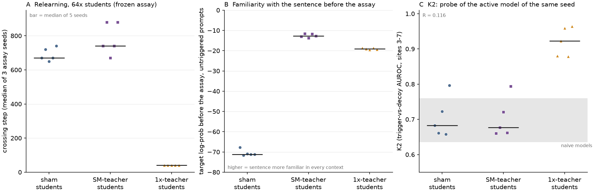

# Phase 4b, third addendum: students of the sentence-memory controls (2026-11-18)

Scored against two predictions committed before any of these runs: `reports/2026-11-17-sm-teacher-arm-plan.md` (assay; committed in e5a377c) and `reports/2026-11-18-k2-sm-teacher-prediction.md` (K2; 5a81aef). The analysis code was also committed before the runs (`zoo.phase4b_smteacher`, 99bdd88). Tables: `results/phase4b/smteacher_*.csv` and `k2_smteacher_*.csv`. Figure: `notebooks/phase4b_smteacher.ipynb`.

## 1. Question

The 1x-teacher students never express the behavior, yet they relearn it about 16 times faster than their sham students. Did they inherit the trigger link from their teacher, or only familiarity with the target sentence? The sentence-memory controls separate the two. Each is naive model k taught the sentence without the trigger, until the sentence is at least as familiar to it as to the 1x teacher of that seed. Their students were made exactly as the 1x-teacher students were: base model, the same stories in the same order, 8,000 steps (64x), with the sentence-memory control as teacher.

## 2. What ran

- **Session:** one Colab session at commit 3c70fa3, on the A100 80 GB (the GPU model of every Phase 4b run), 19:09–23:01 (Colab clock).
- **Runs:** 34, all ok, clean tree (`results/manifest_colab.csv`):
  - 5 distillations and their 5 dose folders;
  - 15 frozen assays (assay seeds 0–2) and 5 vehicle runs;
  - 2 in-batch controls;
  - K2 (`a100k2smteacher`);
  - the tensor-type breakdown (section 6).
- **In-batch controls:** naive and active seed 0 give the same crossing steps as the original A100 assays (640 and 0), with identical curves (largest difference 0).
- **Every SM-teacher student passes the checks of every Phase 4b arm:**
  - Eligible: triggered target_rate at most 0.001, which is 1 of 1,000 sampled completions (seed 0); the limit is 0.01.
  - Clean loss: within 0.007–0.015 of its sham student and 0.028–0.034 of naive.
  - No assay damage: rise at the crossing at most 0.030 above the vehicle.

## 3. Result

*Two predictions held. The students of the sentence-memory controls carry the sentence more strongly than the 1x-teacher students do (B), yet relearn at sham speed (A) and have sham-level K2 (C). A: median crossing step per training seed, with the median over seeds as a bar. B: target log-probability on untriggered prompts before the assay. C: K2, with the range of the naive models shaded.*

Columns:
- **Crossing steps:** assay seeds 0/1/2.
- **L:** log2 ratio of crossing steps, median over assay seeds; negative = faster. The margin is 0.311 (the rule for later arms: max(sham-pair 0.182, naive-pair 0.311)).
- **Untriggered log-prob:** the SM-teacher student / the 1x-teacher student of the same seed.
- **Gap:** triggered minus untriggered log-prob.
- **K2:** SM-teacher / 64x sham / 1x-teacher student.

| seed | SM-teacher student | 64x sham student | 1x-teacher student | L vs sham | L vs 1x-teacher | untriggered log-prob | gap (nats) | K2 | dK2_sham | dK2_1x |
|---|---|---|---|---|---|---|---|---|---|---|
| 0 | 670/770/740 | 670/640/680 | 40/40/40 | +0.12 inside | +4.18 slower | −13.0 / −18.6 | 1.35 | 0.660 / 0.683 / 0.881 | −0.023 | +0.221 |
| 1 | 850/880/890 | 670/760/720 | 40/40/40 | +0.31 inside | +4.43 slower | −11.6 / −19.1 | 0.54 | 0.677 / 0.661 / 0.922 | +0.016 | +0.245 |
| 2 | 670/670/680 | 650/670/580 | 40/40/40 | +0.04 inside | +4.03 slower | −13.8 / −19.5 | 1.87 | 0.721 / 0.722 / 0.959 | −0.002 | +0.239 |
| 3 | 720/760/740 | 670/670/720 | 40/40/40 | +0.10 inside | +4.18 slower | −11.7 / −18.6 | 1.46 | 0.662 / 0.658 / 0.878 | +0.004 | +0.216 |
| 4 | 720/880/890 | 670/760/740 | 40/40/40 | +0.21 inside | +4.43 slower | −12.8 / −19.4 | 1.23 | 0.794 / 0.796 / 0.964 | −0.002 | +0.170 |

**Assay prediction: held.**
- In 5 of 5 seeds, the SM-teacher student is slower than the 1x-teacher student (L +4.03 to +4.43), the plan's threshold being 4 of 5.
- In the same 5 seeds, it is indistinguishable from its sham student (L +0.04 to +0.31).
- Per-seed reading: "trigger link" in 5 of 5.
- Under the plan's table, this supports the trigger-link reading: the 1x-teacher students inherited something beyond the sentence.

**K2 prediction: held.**
- First, the reproduction check passed: active, naive, sham-student and 1x-teacher-student K2 equal the earlier run's exactly (largest difference 0). R = 0.116, as before.
- The SM-teacher students are above their sham in 0 of 5 seeds (dK2_sham −0.023 to +0.016).
- The 1x-teacher students are above the SM-teacher students in 5 of 5 (dK2_1x +0.170 to +0.245).
- Reading: **trigger representation inherited.**
- For comparison only: by T3's threshold (0.768), only seed 4 scores above it (0.794), and its sham student scores the same (0.796).

The two readouts agree.

**Familiarity was larger in these students, not smaller.** Before the assay, the SM-teacher students give the sentence a log-probability of −11.6 to −13.8 on untriggered prompts. The 1x-teacher students give −18.6 to −19.5, and the sham students −68 to −72. The sentence passed through soft labels on clean stories, and more strongly than from the 1x teachers. It did not speed up relearning.

## 4. Controls, and whether they behaved

- **In-batch controls:** reproduced exactly.
- **Sham students:** the same models and runs as in the main arm (the reference of every comparison).
- **Vehicles:** no damage in any run.
- **Against naive (context only, not part of either prediction):** L +0.07 to +0.39. Seeds 0–3 are inside the frozen margin; seed 4 is above it (+0.39). The 64x sham students against naive: −0.07 to +0.18.

The students were never active, so they get no zoo class.

## 5. What went wrong or was surprising

- **The step-0 expectation, as written, was not met.**
  - I expected a triggered-minus-untriggered gap inside the 64x sham students' range (3.2–5.0 nats). The gap is **0.5–1.9 nats**, below that range in 5 of 5. That is close to the teachers' own gap (0.5–1.7) and below the naive models' gap (2.6–4.4; `results/phase4a_sm_check.csv`).
  - The result the expectation guarded against, a trigger-specific gap that would point to the stories, did not appear.
  - I had not anticipated that the students would copy their teacher's flat profile so closely. The expectation compared them with the wrong reference.
- **Target_rate 0 was expected; it was 0 in 4 of 5.** Seed 0 produced 1 of 1,000 triggered completions with the target. Seed 1 produced 1 of 1,000 untriggered completions with the target. Both are well under the eligibility limit.
- **I miscounted in the lab notebook.** Before the session I wrote that 39 runs were missing. The completeness check listed 34. The count is corrected there.

## 6. Tensor-type breakdown (decision 5; descriptive, seed 0)

The unexplained part of the all-tensor student-to-teacher distance is in the token-embedding rows other than the trigger's three. They carry 99.1% of the squared distance in all three arms (norm 47.0–48.6 of a total of 47.2–48.8).
- **Layer matrices:** 4.5, which is 0.9%.
- **The trigger's rows, positional embeddings, layer norms and biases:** 0.11–0.39 each.
- **From the base model:** the same rows carry 94% of each teacher's distance and 91–92% of each student's (`results/phase4b/tensor_types_summary.csv`).

I have not looked at which rows move, or why. That would go beyond the approved analysis.

## 7. Limits

- One base model, one trigger and one target sentence; five seeds; one GPU model.
- The sentence-memory teachers differ from the 1x teachers in more than the link: they were never active, and they learned the sentence by direct training rather than by counter-training.
- The result says that familiarity with the sentence, even more of it, does not reproduce the 1x-teacher students' speed-up or their K2. It does not say what the inherited link is.

## 8. Decisions needed

1. **Research note.**
   - Should the transmission section (preliminary) gain this control?
   - If yes, which: one sentence and the K2 line, or a figure?
   - I would show you the page-text diff first.
2. **Open control 4b (the stories).** Nothing here moves it forward. Keep it open, or close it?
3. **Tensor types.** Do you want to know which embedding rows move (for example, tokens absent from the training stories)? It is CPU only, needs the seed-0 weights from Drive, and would be a new analysis outside the approved plan.
